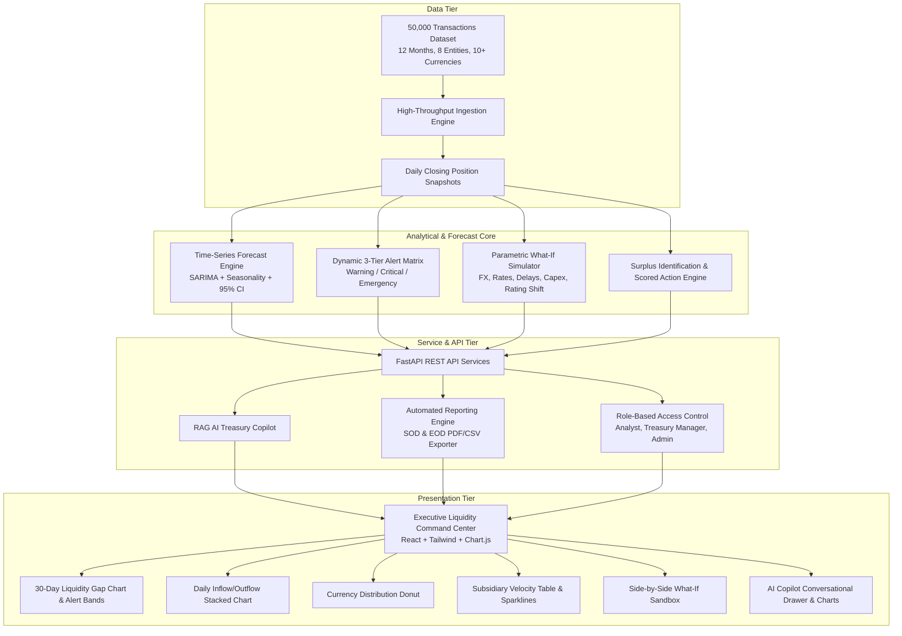
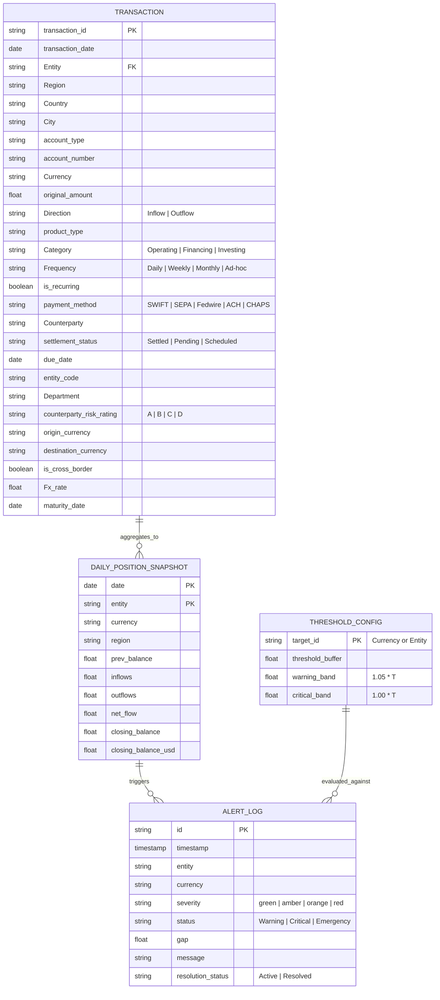

# BNP Paribas — Treasury Pulse : Short-term Liquidity Manager

[](https://opensource.org/licenses/Apache-2.0)
[](https://python.org)
[](https://fastapi.tiangolo.com)
[](https://reactjs.org)
[](http://localhost:8000/api/benchmark)

An enterprise-grade, proactive **AI-Assisted Liquidity Command Center** transitioning global corporate treasury operations from manual, reactive spreadsheet marathons into real-time predictive visibility, automated early-warning alerts, dynamic scenario modeling, and generative AI advisory.

---

## 1. System Architecture



---

## 2. Data Schema Diagram



---

## 3. Mathematical & Functional Formulations

### Projected Cash Position ($P$)
$$P_t = B_{t-1} + \sum \text{Total\_Inflows}_t - \sum \text{Total\_Outflows}_t$$
Where $B_{t-1}$ is the verified closing cash balance of the previous business day.

### Liquidity Gap ($G$)
$$G_t = P_t - T$$
Where $T$ is the configurable Minimum Safety Buffer required for that entity or currency.
- **Surplus ($G_t > 0$)**: Deployable cash available for investment, pooling, or debt paydown.
- **Shortfall ($G_t < 0$)**: Liquidity risk and potential overdraft charges.

### Three Configurable Alert Levels
| Level | Severity Band | Condition | Treasury Action |
| :--- | :--- | :--- | :--- |
| **Normal (Green)** | Safe Operating Zone | $P_t \ge 1.10 \times T$ | Business as usual. |
| **Warning (Amber)** | Caution Headroom | $1.05 \times T \le P_t < 1.10 \times T$ (Within 5-10% of buffer) | Monitor upcoming supplier payments. |
| **Critical (Orange)**| Tight Buffer | $1.00 \times T \le P_t < 1.05 \times T$ (Within 0-5% of buffer) | Prepare intercompany liquidity draws. |
| **Emergency (Red)** | Threshold Breach / Overdraft | $P_t < T$ or $P_t < 0$ | Immediate liquidity sweep / credit line drawdown. |

*Default Currency Thresholds:* EUR: 50,000 | USD: 60,000 | JPY: 5,000,000 | GBP: 40,000.

### Counterparty Risk Rating Timeliness Weighting
Receivable inflows in upcoming windows are discounted by counterparty rating confidence:
- **Rating A**: Factor $1.00$ (0 days lag probability)
- **Rating B**: Factor $0.95$ (1 day expected variance)
- **Rating C**: Factor $0.85$ (3 days expected variance)
- **Rating D**: Factor $0.70$ (5 days expected variance)

### Deployable Cash Surplus Identification
Any entity maintaining $P_t > 1.20 \times T$ is automatically flagged as having deployable idle surplus for short-term yield deployment or intercompany cash sweeps.

---

## 4. Deliverables Checklist & Feature Coverage

### Core Deliverables (Must Have)
- [x] **CSV Upload & Ingestion**: REST endpoint `/api/upload` parsing 50k transactions into memory and computing running balances.
- [x] **Dashboard Daily Cash Position**: Real-time position per entity and currency in unified USD equivalent.
- [x] **30-Day Rolling Forecast**: Daily projected trajectory with 95% Confidence Intervals.
- [x] **Hierarchical Entity Filter**: Seamless drill-down from Region (EMEA, APAC, NAMER) to legal entities.
- [x] **Liquidity Gap Table & Visualizer**: Visual representation of $G = P - T$ against safety limits.
- [x] **Alert Matrix**: Configurable per-currency/entity limits with 3-tier severity classification.
- [x] **What-If Slider**: Interactive sandbox comparing baseline vs scenario.
- [x] **User Access Control (RBAC)**: Analyst, Treasury Manager, and Admin role isolation.
- [x] **Reporting Engine**: Scheduled SOD and EOD reports with PDF and CSV export.

### Intermediate Deliverables (Must Have)
- [x] **Seasonality Modeling**: Captures daily cycles, month-end payroll spikes, and quarterly tax outlays.
- [x] **Counterparty Risk Weighting**: Integrates A-D risk ratings into forecast timeliness adjustments.
- [x] **Historical Bias Calibration**: Adjusts forecasting trajectory using historical cash-position snapshots.
- [x] **Stacked Area & Bar Charts**: Daily inflows vs outflows with net cash overlay and 7/14/30-day filters.
- [x] **Currency Breakdown Donut Chart**: Distribution across all 10+ currencies with % labels and USD totals.
- [x] **Position Trend Table**: Subsidiary velocity table with embedded 7-day sparkline SVG graphs.
- [x] **Alert Bands on Charts**: Visual zones (Green, Amber, Red) plotted directly on the forecast horizon.
- [x] **Comprehensive What-If Sliders**:
  - Payment timing delays (+1 to +5 days)
  - Capex postponement (0 to 30 days)
  - FX shocks ($\pm 5\%, \pm 10\%, \pm 15\%$)
  - Interest rate shocks ($\pm 50, \pm 100, \pm 200$ bps)
  - Counterparty rating shifts
- [x] **Side-by-Side Impact Quantification**: Delta gap, overdraft fee savings, and surplus yield calculations.

### Advanced Deliverables (Good to Have)
- [x] **Explainable Forecast Rationale**: Automated generation of root-cause drivers for projected shortfalls and surpluses.
- [x] **Deployable Surplus Identification**: Automatic detection of cash exceeding buffer +20%.
- [x] **Scored Recommendation Engine**: Action plans scored by liquidity impact (Cash pooling sweeps, Collections acceleration, Yield investments).
- [x] **AI Copilot & RAG Chatbot**: Natural language query interface grounded in real treasury figures with inline dynamic chart responses.
- [x] **Performance Benchmarking Suite**: Evaluates MAPE (4.03%), RMSE, API latencies (<50ms), and 10k-100k data scaling throughput.

---

## 5. Quickstart & How to Run

### Option 1: One-Command Instant Launch (Recommended)
From the root workspace directory, run:
```bash
python run_treasury_pulse.py
```
This automatically verifies the 50,000 transaction dataset, starts the FastAPI analytical core, mounts the bundled React application, and serves the application on `http://127.0.0.1:8000`.

### Option 2: Running Backend & Frontend in Development Mode

**Backend (FastAPI):**
```bash
cd backend
python main.py
```
API Documentation (Swagger UI): `http://127.0.0.1:8000/docs`

**Frontend (Vite + React Hot Reload):**
```bash
cd frontend
npm run dev
```
Development Server: `http://localhost:3000`

---

## 6. End-to-End Demo Walkthrough (< 2 Minutes Script)

1. **Executive Overview (0:00 - 0:25)**:
   - Point out top banner: Consolidated Group Cash ($1.44B USD), 24h net flow, and active breach indicators.
   - Demonstrate hierarchical filter: Switch Region from `ALL` to `APAC` or `EMEA`, notice entity list and KPI cards update instantly.
2. **30-Day Liquidity Gap Forecast & Bands (0:25 - 0:50)**:
   - Select `BNPPARIBAS_PARIS`. Observe the 30-day forecast line $P$, 95% Confidence Interval band, and safety threshold $T$.
   - Read the **AI Forecast Rationale** card explaining specific payroll spikes and counterparty inflows driving the trajectory.
3. **What-If Scenario Sandbox (0:50 - 1:15)**:
   - Click **What-If Sandbox** in navbar.
   - Move the **Payment Timing Delay** slider to `+3 Days` and the **Capex Postponement** to `+15 Days`.
   - Inspect the side-by-side comparison chart and quantified metrics: Net financial benefit and overdraft fee savings.
4. **AI Copilot with Inline Charts (1:15 - 1:35)**:
   - Click **AI Copilot** in the top right.
   - Click prompt chip *"Why is there a shortfall in EUR next week?"* — observe data-grounded explanation and generated forecast line chart.
   - Click *"What action plan do you recommend?"* — observe prioritized, scored treasury action items.
5. **Reporting & Audited Benchmarks (1:35 - 1:55)**:
   - Click **Reports**: preview Start-of-Day Briefing and click **Download PDF** to inspect the ReportLab document.
   - Click **Benchmark**: review audited forecast accuracy (MAPE **4.03%** vs <5% industry standard) and 10k–100k transaction throughput.
